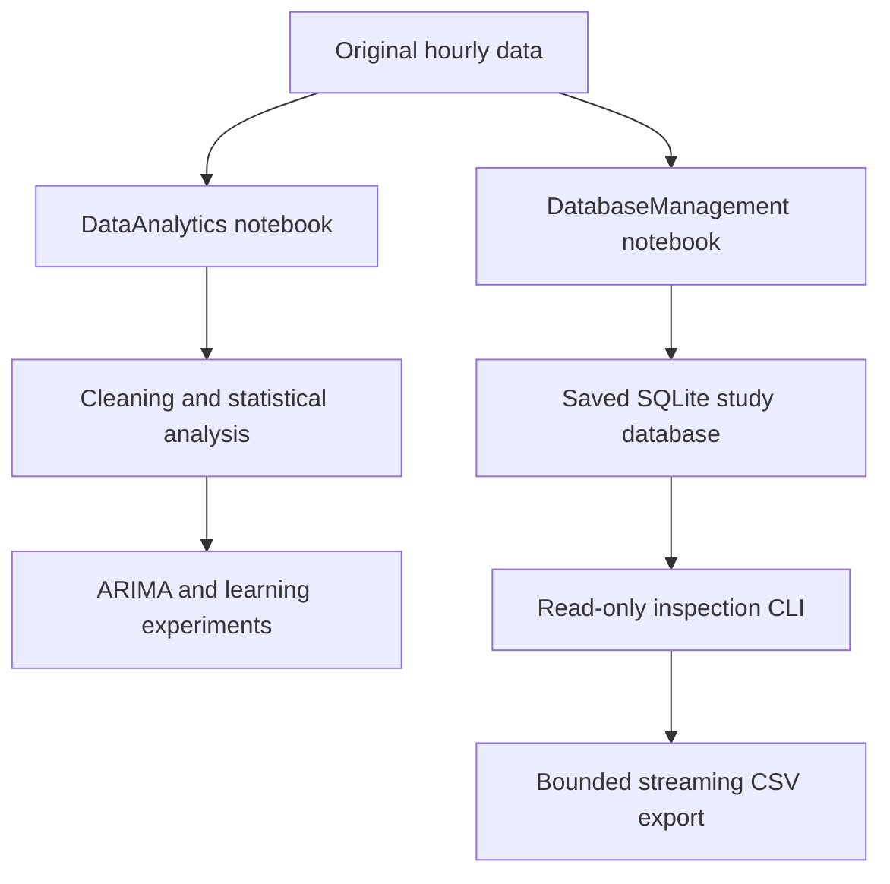

# Car-sharing analysis architecture

Maintenance review: **11 November 2026**. Inspected base commit: `c1338d77b16af250a28eab346fd6e60f103c3b2d`.

Notebook-based database and demand-analysis study. The supplied SQLite database is evidence of the saved study state; historical notebook outputs are not freshly reproduced results.

## Current implementation

| Source boundary | Responsibility and implementation status |
| --- | --- |
| `DatabaseManagement.ipynb` | Schema construction, categorization, SQL reports and mutations. |
| `DataAnalytics.ipynb` | Preprocessing, hypothesis testing, forecasting and model comparisons. |
| `CarSharing.db` | Committed saved study tables; inspected with SQLite read-only mode. |
| `scripts/inspect_database.py` | Standard-library schema/row inventory and bounded export without modifying the saved DB. |

## Changes in this maintenance pass

Added a reproducible entry point that opens the supplied database with SQLite `mode=ro`, refuses absent database paths, safely quotes table identifiers, streams up to a bounded number of rows, and exclusively creates export files. Existing database bytes and historical notebook experiments are preserved. The README now supplies a real clone and read-only quick start.

## Verification and repeatable checks

`python -m unittest discover -s tests -v`; `python scripts/inspect_database.py`. Regressions verify byte-identical source DB preservation, quoted table names, row limits, rejected unknown tables, protected existing output files and explicit missing-file failure.

Record the exact commit and hosted workflow result when reviewing a change. Passing a focused regression does not establish end-to-end reliability or measured capacity.

## Scale and ownership decisions

These are explicit **future design steps**, not implemented infrastructure or measured capacity claims.

| Pressure or boundary | Decision and next evidence |
| --- | --- |
| Data boundary | Preserve immutable raw inputs, schema versions and content hashes; use transactional transformations into a separate output database. |
| Evaluation | Fit imputers/scalers only on training data and use chronological validation for forecasting before reporting model quality. |
| Volume | Use indexed time predicates, chunked CSV/Parquet pipelines and query-plan measurements before replacing SQLite. Keep exploratory notebooks separate from reusable transformations. |

Keep one owner for each data contract, centralize paths/configuration, and review dependency changes with the smallest relevant regression suite. Separate computed results from static fixtures; version inputs with artifacts. Before release, reproduce setup from a clean checkout and check both failure paths and resource cleanup.

## Operational limits and recovery

The original CSV files referenced by notebooks are not committed. The notebooks include mutations and full-dataset preprocessing; their historical model metrics must not be treated as leakage-free deployment estimates. Do not run them against the only database copy. The new CLI provides inspection/export, not a rewrite of those analysis experiments.

Keep a known-good commit and backup mutable experiment artifacts before running migrations or training. On failure, preserve the error and input/configuration version; restore the prior artifact set or checkout the known-good code before retrying. No cloud deployment, paid service provisioning, data migration or production-scale load test was performed by this maintenance pass.
