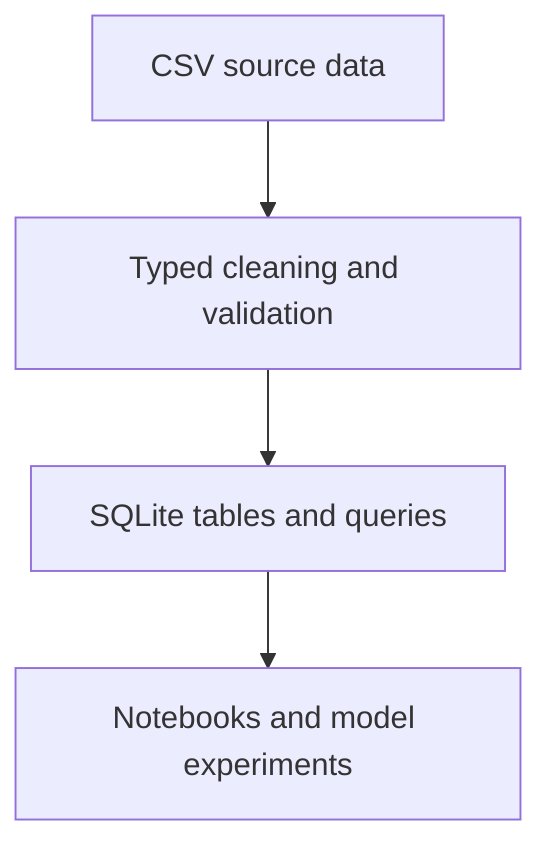
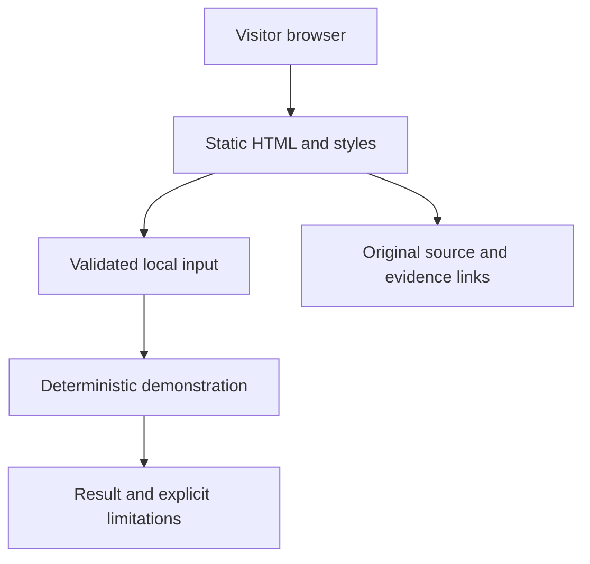

# Engineering review — Data Analytics and Databases

Review date: 14 November 2026. This document records the current portfolio edition and proposed engineering improvements separately from the assessed academic work.

## Original system

Turn a car-sharing dataset into a relational database, then explore demand through SQL, preprocessing and predictive analytics. The original delivery is **Python notebooks + SQLite**. Existing source files, desktop interfaces and relational/data schemas remain authoritative for reproducing the historical implementation.

## Decision 1: Preserve provenance

Keep the assessed source and any group contribution boundaries intact. Add a browser workbench and engineering explanation as a later portfolio edition. Do not relabel the new edition with the original module mark or overwrite the academic evidence. Tradeoff: two surfaces require explicit documentation, but reviewers can distinguish reproducible source from demonstrations.

## Decision 2: Make the boundary explicit

Preserve the original SQLite file and inspect it read-only. Write derived datasets and exports to separate files so a reproducible analysis cannot silently overwrite its source.

SQLite offers a portable, inspectable coursework database with no server to operate. Multiple concurrent writers or hosted APIs would require a separate operational database and migration strategy.

## Data and interface contracts

Make timestamps, demand units, temperature categories and missing-value rules explicit. Validate join keys and row counts. Evaluate forecasting chronologically and compare with a simple seasonal baseline.

The browser workbench filters eight invented rows and reports their arithmetic mean. It is a transparent SQL-style illustration, not a query against the repository database or evidence of forecast accuracy.

## Current web architecture

The web edition is buildless HTML, CSS and JavaScript. It loads a fixed, synthetic example where needed and performs bounded calculations in the browser. User-entered strings are rendered through text nodes; no submitted value is evaluated as source code. It has no analytics, external API calls, database writes or credential requirement. Input state lasts only for the current page session.

## Deployment architecture

Local preview uses a static HTTP server. The intended Sites deployment serves the same `web/index.html` and associated assets. As of this review, Sites publication is pending; the source repository link is not a deployment receipt. A Python/PHP/desktop runtime is not silently hosted by deploying this static page.

A future hosted original application needs a separately described service boundary: authenticated request handling; schema validation; configuration and secret management; bounded workloads; persistent storage ownership; structured errors; audit-safe logs; backup/restore; deployment rollback; and explicit operational responsibility. For training jobs, use a queue and durable job status rather than keeping an HTTP request open. These are proposed requirements, not implemented services.

## Verification strategy

1. Review links and academic figures against the verified module map.
2. Validate browser inputs at their boundary: blanks, malformed values, out-of-range numbers and non-finite values.
3. Compare numerical examples against independent known answers; keep labels clear about synthetic data.
4. Check keyboard navigation, visible focus, readable contrast and small-screen layout.
5. Run the original repository’s documented checks separately. A successful browser demonstration does not prove that the historical GUI, hardware integration or modelling environment starts successfully.

The edition uses semantic headings, labelled form controls, a live result region, responsive layout and reduced-motion support. Browser execution and original-application checks must be reported only when actually completed.

## Operations and failure handling

Keep real datasets, academic identifiers, access tokens and session exports outside the published source. A malformed workbench input produces an explanatory local error. The demo state can be reset by reloading. Static deployment rollback should restore a previously saved, verified version. Before deploying an original backend, define recovery objectives based on the actual users and data rather than inventing uptime guarantees.

## Known limitations

The browser workbench filters eight invented rows and reports their arithmetic mean. It is a transparent SQL-style illustration, not a query against the repository database or evidence of forecast accuracy. Missing university-issued documents remain marked missing. No unavailable assessment component marks, model scores, benchmarks or production claims have been inferred from the final module result.
