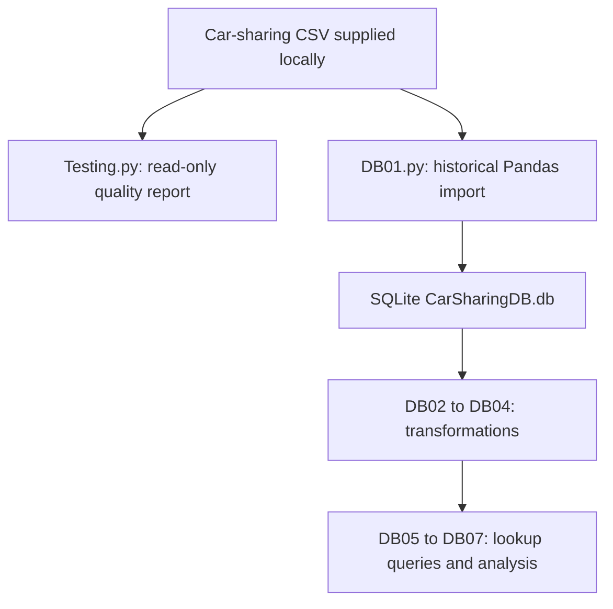

# Car-sharing database coursework: architecture and maintenance

Reviewed source: `1d3abc2fc8f6f87a496c98733eba968e6a35ff10`. Maintenance date: 11 November 2026. This document describes inspected code, the bounded fixes in this change and future work separately. It does not establish production deployment or measured scale. Original coursework/learning material and prior authorship remain identifiable; this maintenance was AI-assisted.

## Implemented architecture



| Component | Source | Responsibility |
| --- | --- | --- |
| Read-only maintained check | Testing.py | Explicit CSV argument; reports row, duplicate and null counts without modifying the input. |
| Historical transformations | DB01.py to DB04.py | Sequential Pandas/SQLite coursework steps, including table replacements. |
| Historical query work | DB05.py to DB07.py | Lookup tables and analysis; some display() calls expect a notebook environment. |

## Engineering decisions in this change

The invalid free-standing heading in Testing.py prevented Python execution. It is now an import-safe read-only CLI with an explicit path, reusable report function and regression. Database transformation scripts are kept identifiable as historical coursework rather than silently converted into a migration system.

## Reproduce checks and run

Run from the repository root with Python 3.12 or Node 22 as appropriate. Use a virtual environment before installing Python dependencies.

```bash
python -m pip install -r requirements.txt
```

```bash
python -m unittest discover -s tests -v
python Testing.py /path/to/CarSharing.csv
```

The regression verifies duplicate/null counts on a synthetic CSV and byte-for-byte input preservation.

## Current boundaries

The historical DB scripts replace/drop tables and depend on a particular schema, execution order and local paths. Run them only on a disposable copy. A backup table in the same SQLite file is not an independent disaster-recovery backup. The read-only checker is the maintained portable entry point; no concurrent database service or production migration runner is claimed.

## Scaling path and acceptance evidence

Before operationalizing transforms, introduce versioned migrations with transaction/rollback tests, schema checks and external backups. Add indexes only for measured query plans. Use chunked duplicate/null aggregation for large CSVs, with an explicit cross-chunk deduplication strategy. Move from SQLite only when measured write contention or availability requirements justify it.

## Maintenance and recovery

Keep data and credentials out of source changes. Reproduce a failure with synthetic inputs before modifying a transformation or user action. Run the focused CI checks, review changes to input/output contracts and retain the prior commit for rollback. Back up local CSV/database inputs outside the working tree before manual runs. Revert the maintenance commit to roll back code; preserve data separately because reverting code does not reverse data mutations. Record environment versions, input schema, failure steps and expected/actual behavior in future bug reports.
